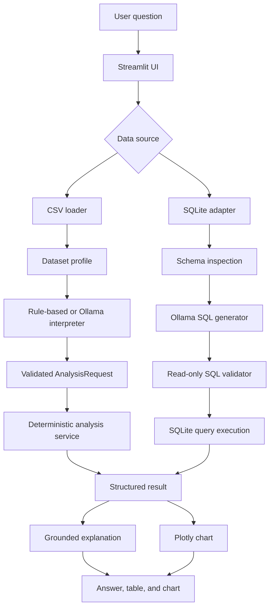

# Architecture

## Overview

The AI Data Analyst Agent converts a natural-language question into a validated analysis request, performs deterministic calculations, and returns a table, explanation, and optional chart.

## Main components

### Data layer

- `csv_loader.py` loads CSV files and creates dataset profiles.
- `sqlite.py` loads SQLite files, inspects schemas, and executes read-only queries.
- `workflow.py` coordinates schema-aware SQL generation and execution.

### AI layer

- `ollama.py` converts questions into validated `AnalysisRequest` objects.
- `sql.py` generates SQL from a known schema.
- Ollama is optional and local. The deterministic rule-based interpreter remains available.

### Analysis layer

- `analysis/service.py` performs summaries and grouped aggregations with Pandas.
- `visualization/charts.py` creates serializable Plotly figures.
- `interpretation/explainer.py` creates explanations from calculated values only.

### Application layer

- `pipeline.py` coordinates interpretation, analysis, explanation, and chart generation.
- `application.py` exposes reusable services for Streamlit today and an API later.
- `app.py` contains the Streamlit presentation layer.

## Safety boundaries

The language model does not directly calculate results or execute arbitrary code.

- SQL is validated as read-only before execution.
- SQL results have row limits.
- Analysis calculations are performed by Pandas or SQLite.
- Model output is converted into typed request models.
- Secrets are excluded from Git through `.gitignore`.

## Current limitations

- SQLite is the only database connector.
- The local AI model requires Ollama and enough memory for the selected model.
- The rule-based interpreter supports a limited set of question patterns.
- Database charts currently focus on bar charts.
- Authentication and deployment are intentionally postponed.
